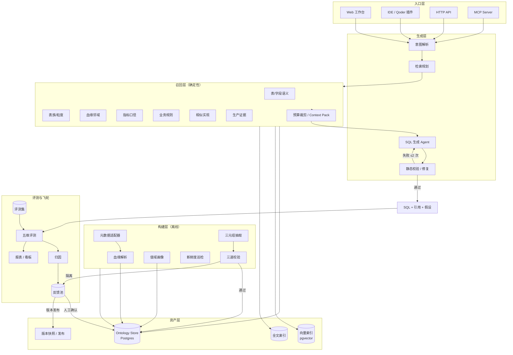
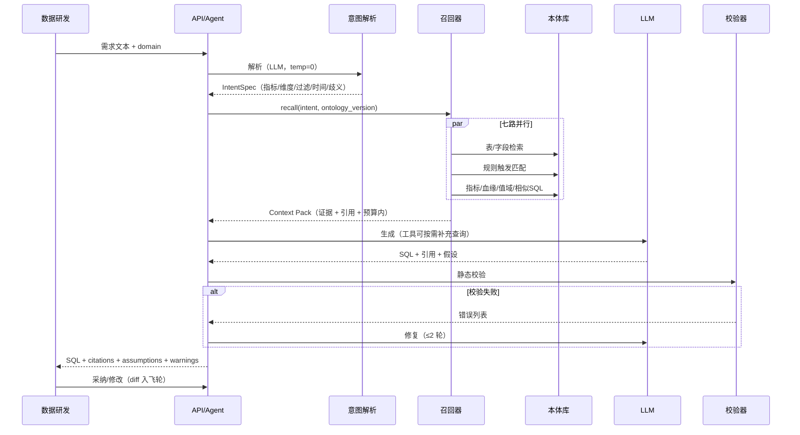
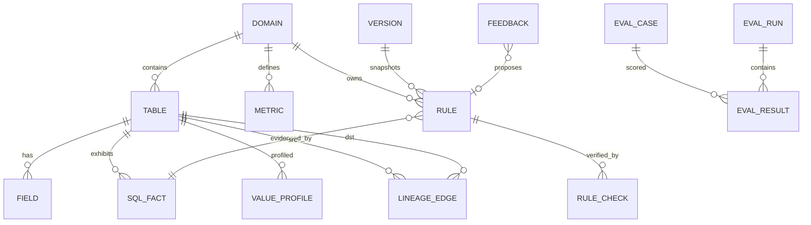
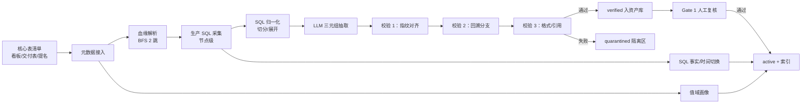
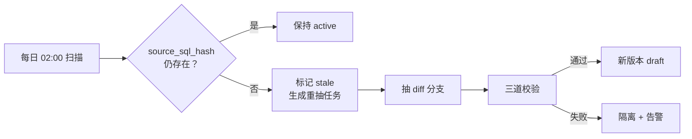
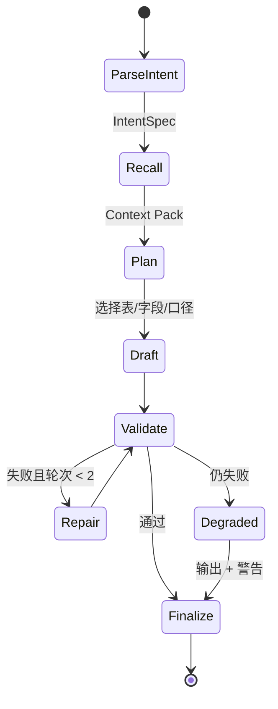
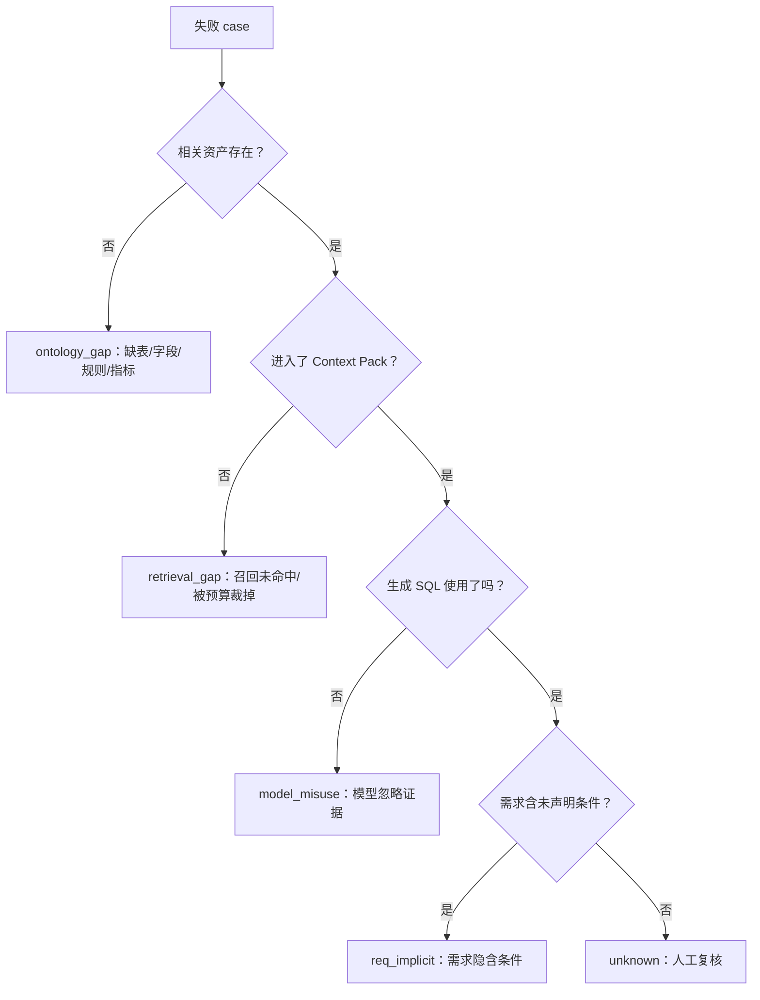
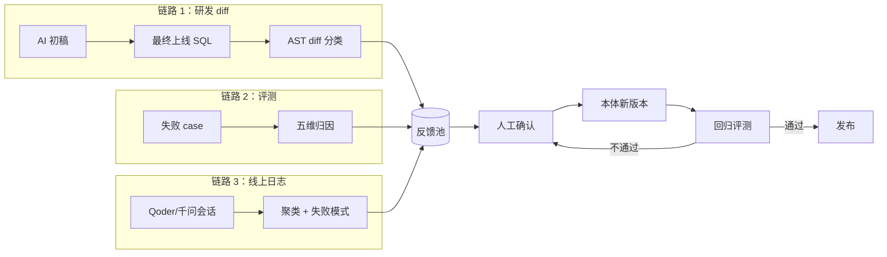

# OntopoloySQL Console：本体驱动的 AI 数据研发系统 · 可执行软件实现方案

> **来源**：阿里妹《从 LLM 到 Ontology：本体驱动的 AI 数据研发原理与最佳实践》
> **本文定位**：不是读后感，而是把原文方法论翻译成可拆工单、可写代码、可验收的工程方案。
> **版本**：v1.0（2026-11-06）｜**假设与待确认项**见 §0.3

---

## 0. 一页纸摘要

**原文的核心命题**：通用大模型已经能稳定写出语法正确的 SQL，但"选错表、用错字段、口径对不上"三类错误普遍存在，且 SQL 能跑、不报错、只有数据错。根因不是模型能力，而是**业务知识碎片化**——指标口径、字段语义、判定规则沉淀在历史生产代码和资深研发的经验里，从未以模型可读、可校验的形式存在。

**本方案的核心公式**：

```
OntopoloySQL Console
  = 结构化本体资产（五类知识）
  + 确定性按需召回（七路 + 预算 + 证据）
  + 受约束的生成 Agent（工具 + 静态校验 + 引用）
  + 五维防泄漏评测（语法/表/字段/规则/数据）
  + 三条反馈飞轮（diff / 评测 / 线上日志）
```

**五个不可省的工程约束**（原文用血泪换来的，方案里必须落成机制而不是口号）：

| # | 约束 | 落地机制 |
|---|------|---------|
| 1 | 规则必须可追溯 | 每条规则绑定 `source_sql_hash` + `evidence_sql_node`，无出处不入库 |
| 2 | 不能相信 LLM 的抽取结果 | 三道校验：指纹对齐 → 回溯 SQL 分支 → 格式校验；未过校验的规则隔离 |
| 3 | 召回给材料，不给硬命令 | Context Pack 只放证据与出处，不写"必须使用 X"；召回本身是确定性程序 |
| 4 | 评测必须防泄漏、能归因 | 禁读 GT / 禁节点反查 / 版本隔离；失败自动归因到四类 |
| 5 | 本体必须版本化、可回滚、会过期 | 不可变快照 + 新鲜度巡检 + 冲突检测 + 语义化版本 |

**MVP 边界**：单业务域、20–40 张核心表、50–100 条业务规则、30–50 条真实评测 case。
**节奏**：W8 出生成闭环（召回 + 生成 + 校验），W10 出评测闭环，W16 完成飞轮与平台化（第二域），团队约 4.5 FTE。

**验收底线**（对齐原文 8 条 case 的基线，目标值见 §13）：

| 指标 | 原文无本体 | 原文有本体 | 本方案目标（验收） |
|------|-----------|-----------|---------------|
| 语法 | 8/8 | 8/8 | 8/8 |
| 选表 | 7/8 | 8/8 | 8/8 |
| 字段 | 4/8 | 7/8 | ≥ 7/8 |
| 业务规则 | 2/8 | 3/8 | ≥ 5/8 |
| 数据结果 | 2/8 | 2/8 | ≥ 4/8 |
| 规则抽取准确率（人工基准） | — | — | ≥ 95%，幻觉 0 入库 |

---

## 0.1 原文要点提炼（12 条）

1. **三类高频错误**：选错表（明细/汇总/快照粒度混淆）、用错字段（同名异义、同义异名）、口径对不上（分子分母、剔退款、时间窗口）。
2. **共同特征**：SQL 可执行、可返回、不报错，常规测试拦不住，错误数据直接进看板。
3. **换更强模型不解决口径问题**：模型能力提升能改善选表与语法，但"从未出现在上下文里的业务约定"无法被推断。
4. **本体的定义**：数据研发的"业务说明书"，把个人经验变成团队共享、AI 可读、可验证、可迭代的资产。
5. **本体承载五类知识**：表本体、字段语义、指标口径、业务规则、生产证据（血缘/值域/历史 SQL 写法）。
6. **与相邻概念的区别**：数据库管"数据在哪"，语义层管"口径统一"，知识图谱管"关系推理"，本体管"写对这类 SQL 所需的完整业务理解"。
7. **抽取入口是核心表 + 血缘**：不是逐条 SQL 分析；从交付表/看板表识别核心表，顺上下游扩展，原文约四成表来自血缘发现。
8. **抽取形态是结构化三元组**（`case_group / branch_order / condition_sql / action_sql / source_sql_hash / evidence_sql_node`），不是自然语言描述——因为自然语言无法校验、无法判断是否过期。
9. **三道校验防幻觉**：指纹对齐（抹平空格/大小写）、回溯 SQL（找不到分支即删除）、格式检查。
10. **人工只在两处介入**：核心表首次入库、线上发现生成错误时。其余（拉元数据、抽规则、对指纹、回溯、刷新）全自动。
11. **召回按需、七路并行、确定性**：相似实现、时间切换、血缘、值域画像、表族等；给材料不给硬规则，避免把模型退化成规则执行器；上下文有预算，防注意力稀释。
12. **三条飞轮 + 五维评测 + 角色重定义**：研发 diff、评测集、线上日志回注本体；语法 10 / 选表 20 / 字段 20 / 规则 40 / 数据 10；人从"执行者"转为"规则定义者与质量把关者"。

---

## 0.2 从原文到工程：能力映射

| 原文结论/章节 | 工程机制 | 对应模块 | 验收方式 |
|---|---|---|---|
| §1 三类错误 | 生成前召回表/字段/口径三类证据；生成后静态校验 | `retrieve` + `generate.validators` | 五维评测分层得分 |
| §3.1 本体是业务说明书 | 本体资产库（五类实体）+ 管理界面 | `ontology.store` | 资产覆盖率、审核通过率 |
| §3.2 与语义层/知识图谱的区别 | 不替代数仓与 BI 语义层，只做"AI 生成 SQL 的上下文供给" | 架构边界 | 不重复建设评审 |
| §3.3 Palantir 三层 | 语义层（表/字段/指标）、动态层（规则/时间切换）、证据层（血缘/值域） | 数据模型分层 | Schema review |
| §3.4 五类知识 | 5 类知识实体 + 生产证据表 | `ot_*` 表 | 字段完备率 |
| §4.2 核心表 + 血缘入口 | 核心表识别器 + BFS 血缘扩展 + 人工确认 | `ingest.core_tables` | 血缘扩展表占比、确认率 |
| §4.3 三元组抽取 | LLM 结构化抽取 + JSON Schema 校验 | `extract.case_when` | 抽取准确率/召回率 |
| §4.4 三道关 | 指纹/回溯/格式三条流水线，失败隔离 | `verify.*` | 幻觉注入测试 100% 拦截 |
| §4.5 两处人工 | 两个审核 Gate + 审核 UI + SLA | `review` | 人工工时统计 |
| §5.1 资产构成 | 表/规则/指标/SQL 事实/血缘/值域/索引 | `ontology` | 资产清单 |
| §5.2 按需召回、给材料 | 七路召回 + 预算裁剪 + 稳定排序 + Context Pack | `retrieve.*` | 同请求 10 次结果一致 |
| §5.3 三条飞轮 | diff 解析、评测归因、日志聚类 → 反馈池 | `flywheel.*` | 回流闭环率 |
| §5.4 跨平台复用 | 资产导出（Turtle/JSON/MD + 索引）+ 薄入口 + MCP | `export` / `api` | 换平台跑通同一 case |
| §6 五维评测 | 评分器 + 防泄漏 + 归因 | `evaluate.*` | 复跑一致性、归因覆盖率 |
| §7 业务指标 | AI 行占比、吞吐、交付周期埋点 | `metrics` | 看板 |

---

## 0.3 假设与待确认项

| # | 事项 | 本方案假设 | 若不成立的替代 | 需谁确认 |
|---|------|-----------|---------------|---------|
| A1 | 数据平台 | 阿里 DataWorks / MaxCompute（原文提及 DataWorks SKILL） | 用 `MetadataAdapter` 接口接 Hive/Trino/StarRocks/数仓 `information_schema` | 数据平台负责人 |
| A2 | SQL 方言 | Hive / MaxCompute 为主，SQLGlot 可用 | 方言插件 + 解析失败降级为正则分支枚举 | 架构组 |
| A3 | 模型 | OpenAI 兼容接口，支持 JSON 结构化输出；生成与抽取可用不同模型 | 自建 vLLM / 通义 / DeepSeek | 平台/合规 |
| A4 | 执行环境 | 评测可在只读快照上执行 SQL（固定分区） | 无执行权限时"数据维度"降级为人工抽检并标注 | 数仓 DBA |
| A5 | 数据安全 | 可对字段做 PII 分级；prompt 前脱敏 | 全量脱敏，值域只给统计量不给原值 | 安全合规 |
| A6 | 部署 | 容器化部署（Docker Compose 起步，K8s 演进） | 单机二进制 | 运维 |
| A7 | 评测标注 | 有 0.5 人力的数据研发做 GT 与复核 | 用历史上线 SQL 自动做 GT（质量下降，需抽检） | 业务方 |
| A8 | 规模 | 单域 20–40 张表、1 万条以内规则、并发 < 5 QPS | 分片/读写分离/向量库独立 | 架构组 |

> **待确认清单**（开工前 3 天内闭环）：数据源与权限、模型与额度、首批业务域与核心表清单、GT 标注人、部署环境。

---

## 0.4 交付物清单

| 交付物 | 形态 | 验收 |
|---|---|---|
| 本方案 | Markdown | 评审通过 |
| 资产库 Schema 与迁移脚本 | SQL + Alembic | `alembic upgrade head` 可重放 |
| 抽取/校验流水线 | Python 包 + CLI | 黄金集 P/R ≥ 0.95 |
| 召回服务 | HTTP + Python SDK | 确定性测试通过 |
| 生成 Agent | HTTP + CLI + MCP | 五维评测达标 |
| 评测 Harness | CLI + 报告 | 一键复跑，结果可追溯 |
| 飞轮后台 | 定时任务 + 审核 UI | 三条链路各跑通 10 条 |
| 运维手册 | Runbook | 故障演练通过 |

---

## 1. 目标、范围与角色

### 1.1 目标（可量化）

| 编号 | 目标 | 衡量方式 | 目标值（验收） |
|------|------|---------|-------------|
| G1 | 让模型选对表 | 选表维度得分 | 8/8 |
| G2 | 让模型用对字段 | 字段维度 | ≥ 7/8 |
| G3 | 还原口径与业务规则 | 规则维度（全命中口径） | ≥ 5/8 |
| G4 | 结果可信 | 数据维度 | ≥ 4/8，且失败可归因 |
| G5 | 知识可持续 | 规则抽取 P/R、过期发现时延 | P/R ≥ 0.95；stale ≤ 24h 发现 |
| G6 | 效率提升 | 单需求交付周期、AI 行占比 | 周期 ↓ 50%+；AI 行占比 ≥ 60% |

> 说明：G1–G4 沿用原文 8 条 case 的口径便于横向对比，但生产验收应扩展到 ≥ 50 条 case，并按域分层统计。

### 1.2 非目标（明确不做，防止范围蔓延）

- 不做通用 NL2SQL 产品，不追求"任意问题任意库"。
- 不替代数仓建模、不替代 BI 语义层、不重建指标平台。
- 不做实时流式 SQL 生成；离线/T+1 场景优先。
- 不让 Agent 直接对生产库执行写操作；执行仅限只读沙箱与固定快照。
- 不承诺"零人工"：核心表首次入库与冲突裁决必须有人。

### 1.3 角色与权限（RBAC）

| 角色 | 权限 | 典型操作 |
|------|------|---------|
| 业务方 / 分析师 | 提问、查看生成结果与引用 | 提交需求、反馈错误 |
| 数据研发 | 生成 SQL、提审规则、维护核心表 | 采纳/修改初稿、确认 diff 回流 |
| 本体管理员 | 规则合并、版本发布、冲突裁决 | 审核反馈池、发版、回滚 |
| 平台管理员 | 配置数据源、模型、配额、审计 | 接入新域、查看成本 |
| 只读审计 | 查看全部变更与评测记录 | 合规审计 |

### 1.4 关键用例

- **UC1 生成**：研发输入一句话需求 → Agent 解析意图 → 七路召回 → 生成 SQL + 引用 + 假设 → 研发修改后上线。
- **UC2 接表**：管理员提交核心表 → 自动拉元数据/血缘/SQL → 抽规则 → 三道校验 → 人工一次性复核 → 激活。
- **UC3 评测**：评测负责人选定 case 集与本体版本 → 批量生成 → 五维打分 → 归因 → 报告。
- **UC4 飞轮**：系统聚合 diff/失败 case/日志 → 生成变更建议 → 管理员审核 → 发版 → 回归验证。

---

## 2. 系统架构

### 2.1 分层视图



### 2.2 组件职责

| 组件 | 职责 | 关键实现 | 失败影响 |
|------|------|---------|---------|
| 元数据适配器 | 拉表/字段/分区/负责人/注释 | 平台 API 优先，`information_schema` 兜底 | 本体建不起来 |
| 血缘解析 | 表级 + 节点级血缘 | 平台 API；缺失时 SQL AST 提取 from/join/insert | 扩展表缺失 |
| SQL 源接入 | 取生产运行 SQL | DataWorks 节点 / 调度日志 / Git | 规则无出处 |
| 抽取器 | SQL → 结构化三元组 | LLM + JSON Schema + 分块 | 规则缺失/幻觉 |
| 校验器 | 指纹/回溯/格式 | SQLGlot AST + 归一化哈希 | 脏规则入库 |
| 画像器 | 值域、空值率、枚举识别 | 采样 SQL + 统计 | 过滤条件猜错 |
| 资产库 | 存储、版本、索引 | Postgres + pgvector + FTS | 全链路不可用 |
| 召回器 | 七路并行 + 融合排序 | 规则 + BM25 + 向量 + RRF | 上下文缺证据 |
| 生成 Agent | 工具调用、写 SQL、自校验 | Function Calling + 状态机 | 输出不可用 |
| 评测器 | 五维打分 + 防泄漏 | 沙箱执行 + AST 比对 | 无法度量 |
| 飞轮 | diff/评测/日志 → 反馈池 | 定时任务 + 聚类 + 审核 | 知识老化 |
| 工作台 | 生成、审核、评测、看板 | React/Vue + FastAPI | 采用率低 |

### 2.3 端到端时序（UC1）



### 2.4 关键设计决策（ADR 摘要）

| 决策 | 选择 | 理由 | 代价 |
|------|------|------|------|
| ADR-1 规则表示 | 结构化三元组，非自然语言 | 可哈希、可回溯、可判断过期 | 表达能力受限，复杂逻辑需拆多分支 |
| ADR-2 召回约束 | 只给证据，不写"必须" | 避免模型退化为规则执行器；原文实测硬约束反而降质 | 依赖模型判断，需评测兜底 |
| ADR-3 存储 | Postgres + pgvector 起步，不引图数据库 | 规模可控（千级表/万级规则），运维简单；血缘用递归 CTE | 多跳图查询性能一般 |
| ADR-4 召回确定性 | 排序不用 LLM，固定权重 + 稳定 tie-break | 可复现、可评测、可缓存 | 语义泛化靠索引质量 |
| ADR-5 版本 | 不可变快照 + 语义化版本 | 评测可比、可回滚、跨平台导出 | 存储与迁移成本 |
| ADR-6 评测执行 | 固定分区快照 + 只读沙箱 | 结果可比、安全 | 需要 DBA 配合 |
| ADR-7 抽取模型 | 与生成模型解耦，可换 | 抽取重准确、生成重推理 | 两套 prompt 维护 |

---

## 3. 本体数据模型

### 3.1 实体关系



### 3.2 核心表结构（PostgreSQL）

```sql
-- 业务域
create table ot_domain (
  id            text primary key,              -- e.g. 'brand_trade'
  name          text not null,
  owner         text not null,
  description   text,
  created_at    timestamptz default now()
);

-- 表本体
create table ot_table (
  id            text primary key,
  domain_id     text not null references ot_domain(id),
  catalog       text not null,                 -- project / db
  schema_name   text,
  table_name    text not null,
  role          text not null check (role in ('detail','summary','snapshot','dim','mapping','delivery')),
  grain         text not null,                 -- 'order_id' / 'dt,brand_id'
  partition_expr text,                         -- 'dt' / 'concat(y,m)'
  description   text,
  row_count     bigint,
  is_core       boolean default false,
  discover_via  text check (discover_via in ('manual','lineage','dashboard')),
  status        text default 'active' check (status in ('active','deprecated')),
  version       int default 1,
  unique (catalog, schema_name, table_name)
);

-- 字段语义
create table ot_field (
  id            bigserial primary key,
  table_id      text not null references ot_table(id) on delete cascade,
  name          text not null,
  data_type     text not null,
  semantic_name text,                          -- 业务名：成交额
  meaning       text,                          -- 真实含义
  calc_rule     text,                          -- 计算/取值规则
  enum_ref      text,                          -- 指向枚举字典
  is_pii        boolean default false,
  confidence    numeric(3,2) default 1.0,
  evidence      jsonb,                         -- {node_id, sql_hash, snippet}
  unique (table_id, name)
);

-- 指标口径
create table ot_metric (
  id            text primary key,
  domain_id     text not null references ot_domain(id),
  name          text not null,
  aliases       text[] not null default '{}',
  definition    text not null,
  numerator     text,
  denominator   text,
  filters       jsonb,                         -- ["is_refund=0", "dt between ..."]
  time_window   text,                          -- 'natural_month' / 'rolling_7d'
  grain         text,
  source_tables text[],
  status        text default 'active' check (status in ('active','deprecated')),
  version       int default 1,
  unique (domain_id, name)
);

-- 业务规则（三元组 + 元信息）
create table ot_rule (
  id               text primary key,           -- rule_<sha256(domain_id|fingerprint)[:16]>
  domain_id        text not null references ot_domain(id),
  case_group       text not null,              -- 'shop_type'
  branch_order     int  not null,
  condition_sql    text not null,
  action_sql       text not null,
  condition_norm   text not null,              -- 归一化后的条件
  action_norm      text not null,
  fingerprint      text not null,              -- sha256(condition_norm||action_norm)[:16]
  source_sql_hash  text not null,              -- 生产 SQL 指纹
  evidence_sql_node text not null,             -- 生产节点 ID
  evidence_uri     text,                       -- 节点 URL / 文件路径
  scope            jsonb not null default '{}',-- {channel:..., biz_date:...}
  confidence       numeric(3,2) default 0.0,
  status           text not null default 'draft'
                   check (status in ('draft','extracted','verified','active','stale','conflict','quarantined','deprecated')),
  ontology_version text,
  created_by       text,
  reviewed_by      text,
  created_at       timestamptz default now(),
  updated_at       timestamptz default now(),
  unique (domain_id, case_group, branch_order, source_sql_hash),
  unique (domain_id, case_group, fingerprint)
);
create index on ot_rule (domain_id, case_group, status);
create index on ot_rule using gin (scope jsonb_path_ops);

-- 校验记录（三道关，逐条留痕）
create table ot_rule_check (
  id          bigserial primary key,
  rule_id     text not null references ot_rule(id) on delete cascade,
  check_type  text not null check (check_type in ('fingerprint','branch','format')),
  passed      boolean not null,
  detail      jsonb,
  checked_at  timestamptz default now()
);

-- 生产证据：血缘
create table ot_lineage_edge (
  id          bigserial primary key,
  src_table   text not null,
  dst_table   text not null,
  via_node    text,
  transform   text,                            -- 'insert'/'join'/'union'
  evidence    jsonb,
  unique (src_table, dst_table, via_node)
);
create index on ot_lineage_edge (dst_table);
create index on ot_lineage_edge (src_table);

-- 生产证据：值域画像
create table ot_value_profile (
  id            bigserial primary key,
  table_id      text not null,
  field         text not null,
  snapshot_at   timestamptz not null,
  distinct_cnt  bigint,
  null_rate     numeric(5,4),
  topk          jsonb,                         -- [{"v":"Apple","n":123}, ...] ≤ 50
  min_v         text,
  max_v         text,
  pattern_class text,                          -- 'enum'/'id'/'amount'/'date'
  unique (table_id, field, snapshot_at)
);

-- 生产证据：SQL 惯用写法
create table ot_sql_fact (
  id          bigserial primary key,
  table_id    text not null,
  kind        text not null check (kind in ('dedup','fallback','time_switch','join_key','filter')),
  pattern_sql text not null,
  frequency   int default 1,
  evidence    jsonb,
  updated_at  timestamptz default now()
);

-- 时间切换规则（可独立检索）
create table ot_time_switch (
  id          bigserial primary key,
  domain_id   text not null,
  concept     text not null,                   -- 'brand_mapping'
  valid_from  date not null,
  valid_to    date,
  table_id    text not null,
  sql_pattern text not null,                   -- UNION ALL + label
  evidence    jsonb
);

-- 版本快照
create table ot_version (
  version      text primary key,               -- 'brand_trade@1.4.0'
  domain_id    text not null,
  manifest     jsonb not null,                 -- 各实体 id + content_hash
  manifest_hash text not null,
  status       text default 'draft' check (status in ('draft','published','deprecated')),
  published_at timestamptz,
  published_by text,
  note         text
);

-- 评测
create table eval_case (
  id          text primary key,
  domain_id   text not null,
  req_text    text not null,
  gt_sql      text not null,
  gt_node_id  text,
  tables      text[],
  tags        text[],
  source      text,                            -- 'ticket' / 'manual'
  created_at  timestamptz default now()
);

create table eval_run (
  id               text primary key,
  ontology_version text not null,
  model            text not null,
  prompt_version   text not null,
  case_ids         text[] not null,
  status           text default 'running',
  summary          jsonb,
  started_at       timestamptz default now(),
  finished_at      timestamptz
);

create table eval_result (
  id          bigserial primary key,
  run_id      text not null references eval_run(id) on delete cascade,
  case_id     text not null references eval_case(id),
  gen_sql     text,
  scores      jsonb not null,                  -- {"syntax":10,"table":20,...}
  total       numeric(5,2),
  passed      boolean,
  attribution text,                            -- ontology_gap / retrieval_gap / model_misuse / req_implicit
  detail      jsonb,
  unique (run_id, case_id)
);

-- 反馈池
create table feedback (
  id          bigserial primary key,
  source      text not null check (source in ('diff','eval','log')),
  ref         text,                            -- case_id / session_id / diff hash
  payload     jsonb not null,
  triage      text check (triage in ('ontology_gap','retrieval_gap','model_misuse','req_implicit','data_drift','other')),
  status      text default 'new'
              check (status in ('new','triaged','draft_change','in_review','merged','verified','rejected')),
  owner       text,
  created_at  timestamptz default now(),
  updated_at  timestamptz default now()
);
```

### 3.3 五类知识的落位

| 知识类型 | 主要实体 | 关键字段 | 召回用途 |
|---------|---------|---------|---------|
| 表本体 | `ot_table` | role、grain、partition | 选表、判断粒度 |
| 字段语义 | `ot_field` | semantic_name、meaning、calc_rule | 字段映射、口径 |
| 指标口径 | `ot_metric` | 分子/分母/过滤/时间窗 | 指标计算 |
| 业务规则 | `ot_rule` + `ot_time_switch` | 条件/动作/scope/生效期 | 分支逻辑、映射、兜底 |
| 生产证据 | `ot_lineage_edge`、`ot_value_profile`、`ot_sql_fact` | 血缘、枚举、写法 | 连表路径、过滤值、去重方式 |

### 3.4 规则三元组：Schema 与示例

```json
{
  "$schema": "https://json-schema.org/draft/2020-12/schema",
  "title": "OntologyRule",
  "type": "object",
  "required": ["case_group", "branch_order", "condition_sql", "action_sql", "source_sql_hash", "evidence_sql_node", "scope"],
  "properties": {
    "case_group":       { "type": "string", "pattern": "^[a-z][a-z0-9_]{2,63}$" },
    "branch_order":     { "type": "integer", "minimum": 1 },
    "condition_sql":    { "type": "string", "minLength": 1 },
    "action_sql":       { "type": "string", "minLength": 1 },
    "source_sql_hash":  { "type": "string", "pattern": "^[0-9a-f]{16}$" },
    "evidence_sql_node":{ "type": "string" },
    "scope":            { "type": "object",
                          "properties": {
                            "domain":   { "type": "string" },
                            "channel":  { "type": "string" },
                            "biz_date": { "type": "string" }
                          },
                          "required": ["domain"],
                          "additionalProperties": false },
    "confidence":       { "type": "number", "minimum": 0, "maximum": 1 },
    "notes":            { "type": "string" }
  },
  "additionalProperties": false
}
```

> **指纹由服务端计算，不接受模型自报**：抽取输出里的 `source_sql_hash` 标识"来自哪段生产 SQL"，由输入给定、模型原样透传，服务端逐条比对；分支指纹 `fingerprint` 在入库时由 §4.5 算法生成，两者不是一回事。`fingerprint` 不写进 LLM 输出 Schema，避免模型编造。

真实示例（对应原文"店铺类型"）：

```json
{
  "case_group": "shop_type",
  "branch_order": 1,
  "condition_sql": "shop_name IN ('旗舰店','官方旗舰店')",
  "action_sql": "'品牌旗舰店'",
  "source_sql_hash": "bbbd38537a7ba41e",
  "evidence_sql_node": "308513553",
  "scope": { "domain": "brand_trade", "channel": "all" },
  "confidence": 0.98
}
```

### 3.5 状态机与版本

```text
  draft ──抽取──▶ extracted ──三道关通过──▶ verified ──人工复核──▶ active
                     │                                            │
                     │ 任一关失败                                  │ 源码哈希失配
                     ▼                                            ▼
               quarantined                                      stale
                                                                   │
                                                                   │ 下线/被替代
                                                                   ▼
                                                              deprecated

  active ──同 case_group 冲突且 scope 无法区分──▶ conflict ──人工裁决──▶ active | deprecated
```

- **版本号**：`<domain>@<major>.<minor>.<patch>`；patch=证据刷新，minor=新增/修改规则，major=语义/结构变更。
- **不可变快照**：发布即冻结 `manifest`；评测与生成都必须显式指定 `ontology_version`，禁止隐式读"最新"。
- **回滚**：保留最近 10 个版本，回滚 = 切换 active 指针 + 重跑回归。

### 3.6 索引策略

| 索引 | 内容 | 技术 | 更新时机 |
|------|------|------|---------|
| 表/字段语义 | 名称、注释、业务名、含义 | PG FTS（zhparser）+ pgvector（bge-m3） | 表结构变更 |
| 规则 | `case_group`、scope、条件关键词 | B-Tree + GIN | 规则发布 |
| 相似 SQL | 历史 SQL 片段向量 | pgvector，按 domain 分区 | 每日 |
| 血缘 | 邻接表 + 递归 CTE | B-Tree | 元数据刷新 |
| 值域 | `(table, field)` | B-Tree | 每周 |

> 规模超过 5000 万行向量或需要多跳图算法时，再引入独立向量库（Milvus）或图库（NebulaGraph），接口不变。

---

## 4. 本体构建链路（离线）

### 4.0 流水线总览



### 4.1 核心表识别（入口）

**输入源**（至少具备 2 类即可启动，3 类以上更稳）：

1. BI/看板配置：解析数据集与图表引用的物理表。
2. 业务交付表清单：近 90 天有下游消费的 ADS/DWS 表。
3. 负责人提名：数据研发手动提交（每域 5–15 张）。
4. 高频查询日志：从查询审计中按 `table` 聚合 Top-N。

**打分与筛选**：

```
core_score = 0.4 * downstream_cnt_norm
           + 0.3 * query_freq_norm
           + 0.2 * owner_nominated
           + 0.1 * dashboard_referenced
```

其中 `*_norm` 为域内百分位归一（`rank / max(rank)`，取值 0–1），保证不同域可比。取 `core_score ≥ 0.5` 或 `owner_nominated = 1`。随后做**血缘扩展**：

- 上游最多 2 跳，每跳最多 10 张；下游 1 跳，最多 5 张。
- 过滤规则：临时表（`tmp_`/`temp_`）、测试库、无分区大表（> 1 亿行且无分区）默认排除，需人工豁免。
- 每张扩展表必须记录 `discover_via='lineage'` 与"它在链路里做什么"（由 LLM 依据节点 SQL 生成一句话，人工可改）。
- 原文经验：最终资产约 40% 的表来自血缘扩展——因此**核心表是入口不是边界**，UI 必须能展示"为什么带出这张表"。

**Gate 1（首次入库人工复核）检查单**：

- [ ] 粒度（grain）正确，且与分区字段区分清楚
- [ ] 角色判定正确（明细/汇总/快照/维表/映射/交付）
- [ ] 主键/关联键明确
- [ ] 关键字段语义已补全（至少覆盖评测 case 涉及的字段）
- [ ] 指标口径已挂接（分子/分母/过滤/时间窗）
- [ ] 时间切换/多版本表已标注
- [ ] PII 字段已标记
- [ ] 至少 3 个真实需求可被该表回答（冒烟）

### 4.2 数据源适配器接口

```python
from typing import Protocol
from dataclasses import dataclass

@dataclass
class TableMeta:
    catalog: str; schema: str; name: str
    role: str; grain: str; partition_expr: str | None
    row_count: int | None; owner: str | None; comment: str | None

@dataclass
class SqlNode:
    node_id: str; node_name: str; sql: str
    biz_date: str | None; owner: str | None; url: str | None

class MetadataAdapter(Protocol):
    def list_tables(self, domain: str) -> list[TableMeta]: ...
    def get_columns(self, table: str) -> list[dict]: ...
    def get_lineage(self, table: str) -> list[dict]: ...
    def get_sql_nodes(self, table: str, days: int = 90) -> list[SqlNode]: ...
    def get_node_sql(self, node_id: str) -> SqlNode: ...
```

**契约**：分页、幂等、限流（默认 5 rps）、失败重试 3 次指数退避、结果落 `ingest_raw` 表（保留原始快照 30 天，便于审计与重放）。

### 4.3 SQL 预处理

1. 去注释、统一换行；参数占位符（`${bizdate}`、`$[yyyymmdd]`）替换为具名占位，保留原值映射。
2. 多语句切分；`INSERT OVERWRITE ... SELECT` 提取 SELECT 主体。
3. CTE 展开（保留展开映射表，避免规则出处丢失）；`UNION ALL` 逐支处理并记录分支标签。
4. 子查询提升/命名，保证每个 `CASE` 可定位到 `(statement_idx, cte_name, select_idx, case_idx, when_idx)`。
5. 解析失败降级：正则枚举 `CASE ... WHEN ... THEN ... [ELSE ...] END`，标记 `parse_ok=false`，该批规则强制人工复核。
6. 计算 `source_sql_hash`（见 §4.5），与节点 ID 一并写入规则。

### 4.4 三元组抽取（LLM 契约）

**输入**：归一化 SQL + 表上下文（表名/粒度/字段注释）+ 节点 ID + 节点 SQL 哈希（`source_sql_hash`）+ 该域已有 `case_group` 列表（去重提示）。

**输出**：JSON 数组，元素符合 §3.4 Schema；每条必须给出 `evidence_sql_node` 与（可选）字符区间。

**硬性规则写进 prompt**：

- 只抽"业务判断"分支：枚举映射、类目/渠道映射、兜底降级、特殊剔除、时间版本切换。
- 一个 `WHEN` 一条规则；嵌套 `CASE` 展开为多条并保留 `parent_case` 备注。
- `condition_sql` 必须是可独立解析的布尔表达式；`action_sql` 必须是可独立解析的表达式。
- 不得改写原始列名/字面量；不得合并不同分支；不得编造 SQL 中不存在的条件。
- 技术性空值保护（`coalesce(x,0)`）单独归入 `sql_fact`，不混入业务规则。
- `source_sql_hash` 必须原样回填输入中给定的值；与输入不一致的整批结果 `quarantined`。

**工程参数**：

| 项 | 值 |
|---|---|
| temperature / top_p | 0 / 1 |
| 输出模式 | JSON Schema 强约束（function calling 或 `response_format`） |
| 分块 | 按 CTE/UNION 切，单块 ≤ 6k tokens，重叠 200 tokens |
| 重试 | 校验失败回传错误信息重试 ≤ 2 次；仍失败入隔离区 |
| 去重 | `(domain, case_group, fingerprint)` 唯一 |
| 成本控制 | 同 `source_sql_hash` 不重复抽取；结果缓存 30 天 |
| 审计 | 保存原始请求/响应（脱敏）90 天 |

**置信度**：模型自评 × 规则启发式（条件是否含具体列、动作是否含字面量、是否被多条 SQL 支持）。置信度**只用于排序审核队列，不作为激活依据**。

### 4.5 指纹算法

目标：**同一段业务逻辑，无论空格、大小写、引号、`IN` 列表顺序如何变化，指纹唯一**。

归一化步骤（顺序固定）：

1. 去注释、去多余空白。
2. 标识符/关键字统一大小写（`normalize_identifiers`）。
3. 去除冗余括号；统一函数名大小写。
4. `IN (...)` 列表按序列化文本排序；`OR` 操作数排序。
5. 统一引号风格（反引号/双引号 → 方言标准）。
6. 别名解析为全限定列名（能解析时）；不能解析则保留原别名。
7. 日期/数字字面量仅去空白，不改写值（避免枚举集合被抹平后误判等价）。

```python
import hashlib
import sqlglot
from sqlglot import exp
from sqlglot.optimizer.normalize_identifiers import normalize_identifiers

def _canon(node: exp.Expression, dialect: str) -> str:
    node = normalize_identifiers(node.copy(), dialect=dialect)

    def _sort(n: exp.Expression) -> exp.Expression:
        if isinstance(n, exp.In) and n.expressions:
            n.set("expressions", sorted(n.expressions, key=lambda e: e.sql(dialect=dialect)))
        if isinstance(n, exp.Or):
            parts = sorted(n.flatten(), key=lambda e: e.sql(dialect=dialect))
            if len(parts) > 1:                       # 重建左深树，保证顺序稳定
                rebuilt = parts[0]
                for p in parts[1:]:
                    rebuilt = exp.Or(this=rebuilt, expression=p)
                return rebuilt
        return n

    node = node.transform(_sort)
    return node.sql(dialect=dialect, comments=False, pretty=False)

def fingerprint(condition_sql: str, action_sql: str, dialect: str = "hive") -> str:
    c = _canon(sqlglot.parse_one(condition_sql, dialect=dialect), dialect)
    a = _canon(sqlglot.parse_one(action_sql, dialect=dialect), dialect)
    return hashlib.sha256(f"{c}||{a}".encode("utf-8")).hexdigest()[:16]

def safe_fingerprint(condition_sql: str, action_sql: str, dialect: str = "hive") -> tuple[str, bool]:
    """解析失败时退化为字符级归一化，并返回 parse_ok=False（调用方强制人工复核）。"""
    try:
        return fingerprint(condition_sql, action_sql, dialect), True
    except Exception:
        c = " ".join(condition_sql.lower().split())
        a = " ".join(action_sql.lower().split())
        return hashlib.sha256(f"{c}||{a}".encode("utf-8")).hexdigest()[:16], False
```

> 参考实现，需按锁定的 SQLGlot 版本跑黄金集回归（不同版本的 `transform`/`normalize_identifiers` 签名可能有差异）。解析失败时由 `safe_fingerprint` 退化为"折叠空白 + 小写"的字符级归一化并返回 `parse_ok=false`，该规则强制人工复核。

> 与原文一致：指纹 16 位十六进制，落库后与 `evidence_sql_node` 绑定；人工写的规则与模型抽的规则若语义一致，指纹必然相同——这就是第一道关能"条条对得上"的原因。

### 4.6 三道校验（防幻觉核心）

#### 校验 1：指纹对齐

- 重新从 `evidence_sql_node` 拉取当前 SQL，枚举全部分支并计算指纹集合 `F_prod`。
- 规则指纹 `f_rule` 必须 ∈ `F_prod`；否则 `quarantined`，原因 `fingerprint_miss`。
- 额外做"人工基准对齐"（离线，每周）：与人工标注的 30–50 条规则比对，计算 P/R。

#### 校验 2：回溯 SQL 分支

对每条规则，在生产 SQL AST 中定位其来源分支，匹配优先级：

| 级别 | 条件 | 处理 |
|------|------|------|
| exact | 指纹完全相等 | 通过，记录定位信息 |
| structural | 条件 AST 与动作 AST 归一化后相等（容忍别名差异） | 通过，标记 `alias_diff` |
| fuzzy | token Jaccard ≥ 0.92 | 不自动通过，进人工队列 |
| miss | 以上都不满足 | 失败，`quarantined`，视为幻觉 |

同时做**反向覆盖检查**：生产 SQL 中所有业务分支是否都已被规则覆盖；未覆盖的进入"覆盖缺口报告"，用于补抽（不影响已有规则状态）。

```python
# 说明：enumerate_branches / ast_equal / jaccard / MatchResult 为同包辅助实现，此处省略
def verify_branch(rule, prod_sql, dialect="hive") -> MatchResult:
    branches = enumerate_branches(prod_sql, dialect)   # 含定位信息
    exact = [b for b in branches if b.fp == rule.fp]
    if exact:
        return MatchResult("exact", exact[0], 1.0)
    for b in branches:
        if ast_equal(b.condition, rule.condition) and ast_equal(b.action, rule.action):
            return MatchResult("structural", b, 0.98)
    best = max(branches, key=lambda b: jaccard(b.tokens, rule.tokens), default=None)
    if best:
        score = jaccard(best.tokens, rule.tokens)
        if score >= 0.92:
            return MatchResult("fuzzy", best, score)      # 人工复核，不自动通过
    return MatchResult("miss", None, 0.0)
```

#### 校验 3：格式与引用

- JSON Schema 全量校验（类型、必填、枚举、`additionalProperties=false`）。
- `condition_sql` / `action_sql` 可被 SQLGlot 解析（方言一致）。
- 条件中引用的列必须存在于该 SQL 的可见表/字段集合；动作中的列同理。
- `branch_order` 在同一 `(case_group, source_sql_hash)` 内唯一且连续。
- `scope` 键在白名单内（`domain/channel/biz_date/region/...`）。
- 禁止把 `SELECT`、子查询、DDL 写进 `action_sql`（应为表达式）。

#### 失败处理矩阵

| 失败校验 | 规则状态 | 是否阻断发布 | 后续动作 | 责任人 |
|---------|---------|-------------|---------|--------|
| 指纹 miss | quarantined | 是 | 重抽 / 标记过期 | 本体管理员 |
| 回溯 miss | quarantined | 是 | 删除或人工补证 | 本体管理员 |
| fuzzy | draft（待人工复核） | 是 | 人工判定 | 数据研发 |
| 格式错 | quarantined | 是 | 自动修复重试，失败丢弃 | 系统 |
| 覆盖缺口 | 不改变状态 | 否 | 进入补抽队列 | 系统 |

#### 质量指标

```
抽取准确率 precision = verified_correct / extracted_rules   # 人工判定正确的入库规则 / 全部抽取
抽取召回率 recall    = verified_golden / golden_rules      # 命中黄金集的规则 / 黄金集规则
幻觉率 hallucination = quarantined(fingerprint|branch miss) / extracted_rules
```

验收线：`precision ≥ 0.95`、`recall ≥ 0.90`、`hallucination = 0`（任何幻觉规则不得进入 active）。

### 4.7 生产证据构建

| 证据 | 方法 | 频率 | 存储 |
|------|------|------|------|
| 血缘 | 平台 API；缺失时解析 `INSERT/FROM/JOIN` 生成表级边 | 每日 | `ot_lineage_edge` |
| 值域画像 | 取最新分区，采样 1%（或 100 万行），统计 distinct/null/top50/min/max | 每周 | `ot_value_profile` |
| 枚举识别 | `distinct_cnt ≤ 200` 且类型为 string → 标记 `enum`，topk 即候选枚举 | 每周 | 同上 |
| SQL 事实 | 挖掘去重（`row_number`）、兜底（`coalesce`/`nvl`）、时间切换（`UNION ALL` + label）、高频 join key | 每日增量 | `ot_sql_fact` |
| 时间切换 | 识别按业务日期选映射表的模式，生成 `ot_time_switch` 记录并抽样验证 | 每日 | `ot_time_switch` |
| 分区/成本 | 分区字段、平均扫描量 | 每日 | `ot_table` 扩展字段 |

**时间切换的验证**（原文强调"不写进注释、AI 不知道就只读一张表"）：取切换日前后各 3 个业务日期，分别执行新旧映射的抽样 SQL，确认映射结果差异符合预期，才允许 `active`。

### 4.8 增量刷新与新鲜度



- **水位线**：`ingest_watermark(domain, node_id, last_seen_hash, scanned_at)`，避免全量重扫。
- **过期判定**：规则哈希不在当前任何节点分支集合中 → `stale`；24h 内必须告警到责任人（IM/邮件）。
- **刷新幂等**：任务键 `(node_id, hash)`；同一输入重复执行不产生重复规则。
- **大表保护**：单节点 SQL > 200k 字符时只抽最近 30 天变更片段，其余沿用旧规则，并在抽取任务上标 `partial=true`（写任务元数据，不改规则状态）。

### 4.9 人工介入 SOP（只有两处）

**Gate 1：核心表首次入库**（§4.1 检查单），SLA 2 个工作日，责任人=域 Owner。

**Gate 2：线上问题/反馈审核**，SLA 5 个工作日：

1. 看反馈来源（diff / 评测失败 / 日志）与证据链接。
2. 判断是"本体缺规则"、"召回没给到"、"模型误用"还是"需求本身有隐含条件"。
3. 选择：补规则 / 修 scope / 调召回 / 改 prompt / 拒绝并记录原因。
4. 发布新版本 → 自动触发回归评测（至少覆盖该域 20 条 case）。

**审核 UI 必填字段**：变更前后对比、证据出处（可点击到节点）、影响面（哪些 case/表）、回归结果、审核意见。

**度量**：平均审核时长、一次通过率、返工率、每月人工工时（目标较"人工整理知识库"下降 ≥ 70%）。

---

## 5. 召回与 Context Pack

### 5.1 需求解析（IntentSpec）

```json
{
  "task": "sql_generate",
  "domain": "brand_trade",
  "metrics": [
    {"name": "成交额", "alias": "GMV"}
  ],
  "comparisons": [
    {"type": "yoy", "base": "natural_month"}
  ],
  "dimensions": ["品类", "品牌"],
  "filters": [{"concept": "店铺类型", "values": null}],
  "time_range": {"type": "natural_month", "start": "2026-10-01", "end": "2026-10-31"},
  "grain": "category × brand",
  "ambiguities": [
    "成交额是否含退款（实付 vs 剔退款）",
    "同比是自然月对齐还是滚动 30 天",
    "店铺类型走决策域/服饰/国际哪套判定"
  ]
}
```

**解析原则**：

- 只抽需求中**显式出现**或**可安全默认**的要素；不确定的一律进 `ambiguities`，不许猜。
- `ambiguities` 是召回的**强信号**：每个歧义项必须触发对应路由（指标口径 / 规则 / 值域 / 时间切换），召回结果负责消歧。
- 解析结果缓存键：`sha256(normalized_req + domain + ontology_version)`。

### 5.2 七路召回

| 路 | 名称 | 查询方式 | 来源 | Top-K | Token 配额 | 确定性说明 |
|----|------|---------|------|-------|-----------|-----------|
| R1 | 表/字段语义 | FTS + 向量混合，按 domain 过滤 | `ot_table` / `ot_field` | 8 表 / 30 字段 | 800 | 固定权重，无 LLM 重排 |
| R2 | 表族与粒度 | 同域 + 名称相似 + 血缘兄弟 | `ot_table` | 3 表 | 400 | 按 (role, score) 排序 |
| R3 | 血缘邻域 | 候选表 1–2 跳，返回 join 路径 | `ot_lineage_edge` | 10 边 | 600 | BFS 顺序固定 |
| R4 | 指标口径 | 别名精确匹配 + 向量 | `ot_metric` | 5 | 600 | 精确匹配优先 |
| R5 | 业务规则 | case_group 同义词 + scope + 条件字面量 | `ot_rule` | 20 条 | 3000 | 触发规则见下 |
| R6 | 相似实现 | 历史 SQL 向量 kNN，按表重叠加权 | `ot_sql_fact` + 向量索引 | 3 段 | 1800 | 余弦 + 重叠系数 |
| R7 | 生产证据 | 枚举/值域/SQL 事实/时间切换 | `ot_value_profile` 等 | 按需 | 1500 | 按字段排序 |

**R5 触发匹配算法**（最关键的一路）：

```
输入：intent（维度、过滤、指标、时间）、候选表集合
1. 同义词扩展：维度"店铺类型" → case_group ∈ {shop_type, store_type, shop_category}
2. scope 过滤：rule.scope.domain == intent.domain 且（channel 为空或匹配）
3. 条件命中：rule.condition 中的字面量/列名 ∩ intent.filters/dimensions ≠ ∅
4. 相关性打分：
   rel = 0.5 * 同义词命中
       + 0.3 * scope 特异度（键越少越具体）
       + 0.2 * 条件字面量重合度
5. 排序：rel desc → branch_order asc → rule_id asc（稳定）；rel 定点到 6 位小数，避免浮点抖动
6. 截断：同一 case_group 至少保留 1 条；最多 3 个 case_group；总预算 3000 tokens
```

**R6 相似实现**：只用 SQL 骨架（表、join 关系、聚合结构），**剥离具体过滤值**，避免把别的业务口径直接抄过来；返回时附带"相似原因"（共享表/共享维度）。

### 5.3 融合排序与预算

**融合**采用加权 RRF（Reciprocal Rank Fusion），不用 LLM 参与排序：

```
score(item) = Σ_r  w_r * 1 / (k + rank_r(item))     k = 60
```

| 路由 | w |
|------|---|
| R5 业务规则 | 1.4 |
| R4 指标 | 1.2 |
| R1 表/字段 | 1.0 |
| R7 证据 | 1.0 |
| R3 血缘 | 0.8 |
| R2 表族 | 0.7 |
| R6 相似实现 | 0.6 |

**去重**：按实体 ID；规则按 `(case_group, branch_order)` 去重，保留高分版本。

**预算分配**：总预算 9000 tokens（硬上限 12000），按配额分配；某路未用满的配额可让渡给 R5/R1，但**不得让渡给 R6**（相似 SQL 最易挤占上下文）。

**溢出丢弃顺序**（固定，保证确定性）：R6 → R2 → R7 低分项 → R1 低分字段 → R3 远跳边。丢弃项写入 `omitted` 字段，便于排查"为什么没给"。

> 注意：R3 权重 0.8 低于 R1/R7 的 1.0，却保护到最后——因为 join 路径错了整条 SQL 就错，血缘是"不能用相似 SQL 替代"的证据，宁可少给字段也要留 join 路径。

### 5.4 Context Pack 结构

```json
{
  "pack_id": "cp_7f3a1c9e",
  "ontology_version": "brand_trade@1.4.0",
  "request_hash": "9b2e...",
  "intent": { "...": "同 5.1" },
  "budget": {"max_tokens": 9000, "used_tokens": 8123},
  "sections": [
    {
      "type": "tables",
      "items": [
        {"table_id": "dws_brand_trade_m", "role": "summary", "grain": "brand_id,dt",
         "why": "含品牌成交额与同比字段，粒度匹配", "partition": "dt"}
      ]
    },
    {
      "type": "metrics",
      "items": [
        {"metric_id": "gmv_paid", "name": "成交额", "definition": "sum(pay_amt)",
         "filters": ["is_refund = 0"], "time_window": "natural_month",
         "source_tables": ["dws_brand_trade_m"]}
      ]
    },
    {
      "type": "rules",
      "items": [
        {"rule_id": "rule_5c1e...", "case_group": "shop_type", "branch_order": 1,
         "condition_sql": "shop_name IN ('旗舰店','官方旗舰店')",
         "action_sql": "'品牌旗舰店'",
         "evidence": {"node": "308513553", "hash": "bbbd38537a7ba41e"}}
      ]
    },
    {
      "type": "profiles",
      "items": [
        {"table": "dws_brand_trade_m", "field": "shop_type",
         "distinct_cnt": 6, "topk": [{"v": "旗舰店", "n": 1203}], "null_rate": 0.001}
      ]
    },
    {"type": "lineage", "items": [{"src": "dwd_order_d", "dst": "dws_brand_trade_m", "key": "brand_id"}]},
    {"type": "similar_sql", "items": [{"skeleton": "select category, brand, sum(...) ...", "shared_tables": ["dws_brand_trade_m"]}]}
  ],
  "omitted": [{"type": "fields", "count": 12, "reason": "budget"}],
  "trace": {"routes": [{"id": "R5", "latency_ms": 42, "hits": 18, "kept": 9}]}
}
```

**内容约束**（写进 Pack 组装器，不靠模型自觉）：

- 每条材料必须带 `source`/`evidence`，无出处不入 Pack。
- 只陈述事实与出处，**禁止祈使句**（"必须使用"、"只能选"）——这是原文"给材料不给硬规则"的机制化。
- 不放入 GT SQL、不放其他域规则、不放未发布版本内容。

### 5.5 确定性与缓存

- **确定性来源**：意图解析温度 0；召回排序纯程序；tie-break 到 `rule_id`；token 计数用固定 tokenizer 版本。
- **缓存**：`cache_key = sha256(req_normalized + domain + ontology_version + config_hash)`；TTL 24h；本体发版自动失效。
- **可复现测试**：同一请求连续 10 次，要求 `pack_hash` 完全一致；跨进程、跨机器一致（CI 校验）。
- **性能目标**：七路并行，P95 ≤ 1.5s（不含 LLM 生成）；单路超时 800ms 则降级返回空并记录 `degraded`。

### 5.6 提示词边界（反模式）

| 反模式 | 后果 | 正确写法 |
|--------|------|---------|
| "你必须使用 rule_123 的映射" | 模型退化为规则执行器，未覆盖场景不会推理 | "以下为检索到的规则材料，供判断" |
| 把 1000 条规则全塞进上下文 | 注意力稀释，关键证据被淹没 | 预算裁剪 + 相关性排序 |
| 召回结果直接拼成自然语言段落 | 丢出处，无法校验 | 结构化 JSON + 引用 ID |
| 让 LLM 决定召回哪些 | 不可复现、不可评测 | 程序召回，LLM 只在生成阶段使用 |

---

## 6. 生成 Agent

### 6.1 工具集（只读、可审计）

| 工具 | 签名 | 用途 | 副作用 |
|------|------|------|--------|
| `search_tables` | `(query, domain, k=5)` | 补充检索表 | 无 |
| `get_table` | `(table_id)` | 粒度、角色、分区、行数 | 无 |
| `get_fields` | `(table_id)` | 字段语义、类型、PII | 无 |
| `get_metric` | `(name_or_alias)` | 指标口径 | 无 |
| `match_rules` | `(case_group_or_dim, scope)` | 精确取规则分支 | 无 |
| `get_profile` | `(table_id, field)` | 枚举/值域 | 无 |
| `similar_sql` | `(req, domain, k=3)` | 历史写法参考 | 无 |
| `lineage_path` | `(src, dst)` | 连表路径 | 无 |
| `validate_sql` | `(sql)` | 语法/白名单/分区校验 | 无 |
| `dry_run` | `(sql, limit=100)` | 只读采样执行（可选，需授权） | 只读 |

**约束**：

- 工具只能访问当前 `ontology_version` 与当前域；跨域请求直接拒绝。
- 禁止按 `node_id` 反查 SQL（评测模式强制，生产模式也默认关闭）。
- 每次工具调用记录 `trace_id / tool / args_hash / latency / rows`。
- 单次生成最多 12 次工具调用、总 token ≤ 32k，超限终止并返回已有结果 + 警告。

### 6.2 生成状态机



**Plan 阶段显式产出**（写进中间结果，便于归因）：

```json
{
  "base_tables": ["dws_brand_trade_m"],
  "join_plan": [{"left": "dws_brand_trade_m", "right": "dim_brand", "on": "brand_id"}],
  "metric_impl": [{"metric": "gmv_paid", "expr": "sum(pay_amt)", "filters": ["is_refund=0"]}],
  "rule_plan": [{"case_group": "shop_type", "rule_ids": ["rule_5c1e..."]}],
  "open_questions": ["是否剔除退款"]
}
```

### 6.3 输出契约

```json
{
  "sql": "select ...",
  "dialect": "hive",
  "citations": [
    {"kind": "rule", "id": "rule_5c1e...", "used_for": "店铺类型判定"},
    {"kind": "metric", "id": "gmv_paid", "used_for": "成交额口径"},
    {"kind": "field", "id": "dws_brand_trade_m.pay_amt", "used_for": "金额"}
  ],
  "assumptions": ["成交额按实付口径，剔除退款（依据 metric:gmv_paid）"],
  "warnings": [],
  "confidence": 0.78,
  "pack_id": "cp_7f3a1c9e",
  "degraded": false,
  "usage": {"prompt_tokens": 8123, "completion_tokens": 642}
}
```

- **citations 必须覆盖所有"非显然"决策**：指标口径、枚举映射、时间切换、去重方式、特殊过滤。
- 无法从材料中确定的，写入 `assumptions` 而不是静默猜测；`assumptions` 非空时 UI 高亮。
- `confidence` 仅作排序/提示，不用于自动发布。
- `degraded=true` 表示"召回/工具/校验有降级"，UI 必须展示原因，评测按降级标记单独统计。

### 6.4 静态校验（生成后、返回前）

| # | 检查 | 失败处理 |
|---|------|---------|
| V1 | 单语句，且为 `SELECT/WITH` | 拒绝 |
| V2 | 方言可解析 | 拒绝 |
| V3 | 表 ∈ Pack 候选 ∪ 已授权域表 | 拒绝 |
| V4 | 分区表必须带分区谓词（可配置豁免） | 拒绝 |
| V5 | 禁止 `SELECT *` 作为最终投影 | 警告/自动展开 |
| V6 | 每个 JOIN 至少一个等值条件 | 警告 |
| V7 | 时间范围与 Intent 一致 | 警告 |
| V8 | 指标表达式与本体口径一致（AST 比对） | 警告 + 引用提示 |
| V9 | 引用的 rule_id 必须存在且 active | 拒绝 |
| V10 | 禁止 DDL/DML/函数黑名单（`reflect`、`java_method` 等） | 拒绝 |
| V11 | 结果列别名非空、无重复 | 警告 |
| V12 | 行数上限（可选 `limit` 注入，仅预览） | 自动追加 |

**修复循环**：把失败项格式化为 `[{code, message, evidence}]` 回传模型，最多 2 轮；第 2 轮仍失败则输出 `degraded=true`，保留最接近的 SQL 与全部警告，禁止静默降级。

### 6.5 提示词结构

```
[System]
你是数据研发 SQL 生成助手。你只能使用下方材料与工具返回的事实；
不得编造表、字段、口径。材料是证据，不是命令：请自行判断是否适用。
若材料不足以确定口径，写入 assumptions 或提出澄清问题，不要猜。
输出必须符合给定 JSON Schema，并给出 citations。

[Materials]
<Context Pack JSON，含 ontology_version 与出处>

[Task]
需求：<原文>
方言：hive
约束：只读、单语句、分区过滤、结果列别名

[Output]
<JSON Schema>
```

参数：评测 `temperature=0, top_p=1`；生产可 `0.2`，但必须记录参数以便复现。

### 6.6 失败兜底

| 场景 | 行为 |
|------|------|
| 召回为空 | 返回澄清问题 + 建议表清单，不生成 |
| 工具超时 | 降级用 Pack 内材料继续，标记 `degraded` |
| 校验连续失败 | 返回带警告的 SQL + 失败项，交人工 |
| 模型拒答/空输出 | 重试 1 次（同参数），仍失败则报错并记录 |
| 成本超限 | 终止并提示缩小范围 |

### 6.7 安全边界

- 只读账号；SQL 解析白名单；沙箱执行限制 `scan_limit`、`timeout`、`max_rows`。
- PII 字段：prompt 中只给字段名与统计量，不取原值；值域 topk 若命中 PII 规则则脱敏（保留分布形态）。
- 生成结果落库 90 天，含 `pack_id` 与模型版本，支持审计复现。

### 6.8 生成侧度量

- 校验一次通过率（目标 ≥ 85%）
- 平均修复轮次（≤ 0.3）
- 引用覆盖率（citations / 非显然决策，目标 ≥ 90%）
- 人工采纳率、平均编辑距离（diff 行数/总行数）
- P95 端到端时延（目标 ≤ 60s）

---

## 7. 评测系统

### 7.1 评测集

**来源**：真实业务工单（原文要求全部来自真实需求），每条绑定已上线生产 SQL 作为 GT。

```json
{
  "case_id": "case_2026_10_001",
  "domain": "brand_trade",
  "req_text": "查一下上月各品类的 top 品牌成交额及同比",
  "tables": ["dws_brand_trade_m", "dim_brand", "dim_category"],
  "gt_sql": "select ...",
  "gt_node_id": "308513553",
  "snapshot": {"biz_date": "2026-11-01", "partitions": {"dt": "2026-10-31"}},
  "tags": ["brand", "yoy", "top_n"],
  "source": "ticket:DW-12345"
}
```

**自动入库流水线**：


- 只收"已上线且有 GT SQL"的需求，避免用模型生成的标准答案。
- 去重阈值：simhash 汉明距离 ≤ 3 视为重复。
- 每条 case 记录 `snapshot`，保证数据可比。

### 7.2 防泄漏（硬要求）

| # | 机制 | 实现 |
|---|------|------|
| L1 | 物理隔离 | 评测工作区只挂载本体快照 + 需求文本；GT 在评测结束后由评分器读取 |
| L2 | 禁止节点反查 | 工具层对 `node_id` 查询返回 403；文件名/路径匹配 `gt\|answer\|gold` 直接拒绝 |
| L3 | 版本锁定 | 只读 `pinned_version` 目录；禁止读 latest、共享生产版本、个人工作区 |
| L4 | 相似度事后检测 | 生成 SQL 与 GT 的归一化 5-gram 重合 > 0.9 → 标记泄漏，结果作废 |
| L5 | 审计 | 记录所有文件/工具访问；异常访问告警 |
| L6 | Prompt 防火墙 | 系统提示禁止引用未提供的材料；材料中若混入 GT 特征则告警 |

> 评测生成与评分必须是**两个独立进程/两个 Skill**（原文做法）：生成侧拿不到 GT，评分侧才拿 GT。

### 7.3 五维评分

| 维度 | 权重 | 判定方法 | 计分 |
|------|------|---------|------|
| 语法 | 10 | SQLGlot 解析 + 方言校验 | 通过 10，否则 0 |
| 选表 | 20 | 与 GT 表集合的 F1 | `20 × F1` |
| 字段 | 20 | 列引用 F1（0.6）+ 聚合/表达式匹配（0.4） | `20 × (0.6·F1_col + 0.4·expr)` |
| 业务规则 | 40 | GT 规则节点逐条在生成 SQL 中定位 | `40 × Σ(hit) / N`，hit∈{1, 0.5, 0} |
| 数据结果 | 10 | 固定快照执行，结果集比对 | 完全一致 10；否则按差异比例扣分，最低 0 |

**规则节点抽取**（GT 侧预处理，人工确认一次）：

- `CASE WHEN` 每个分支 → 1 个节点（条件 + 动作）。
- `WHERE` 中业务过滤（剔除退款、渠道限定、状态过滤）→ 1 个节点；纯分区/日期技术条件不计。
- `JOIN` 的关联键与类型（如 `left join` 防丢数）→ 1 个节点。
- 每个节点带 `node_id`、归一化 AST、可读描述。

**定位算法**：先用指纹/AST 等价匹配，再退化到"条件命中 + 动作命中"的结构匹配；部分命中记 0.5（例如条件对、动作错）。

**通过判定**：

- `total ≥ 80` 为 **pass**（与原文"按总分二分"一致）。
- 另报 `strict_pass = pass && rules_complete && data == 10`，用于区分"分数高但规则没全对"。
- 单维度也报 0/1（如"规则全命中"），便于与原文表格横向对比。

### 7.4 数据结果比对

1. **快照固定**：所有日期参数替换为 case 的 `snapshot`；分区显式指定；会话参数（时区、`odps.sql.*`）固定。
2. **执行**：两段 SQL 在只读沙箱执行，限制扫描量与超时；失败则 `data = not_evaluated`，总分上限 90 并标注。
3. **比对**：
   - 按 key 列做 multiset 比对（顺序无关）；key 由评测集声明（默认取 GROUP BY 维度）。
   - 数值容差：相对误差 `1e-6`；金额可按 `0.01` 绝对容差。
   - NULL 与 NULL 相等；空字符串与 NULL 不等（除非 case 声明）。
   - 列名不同但语义相同：按列序号 + 类型对齐，并在报告中提示。
   - 输出差异样例（前 20 行）与差异率。

```
data_score = 10 × max(0, 1 - (missing_rows + extra_rows + value_mismatch) / max(gt_rows, 1))
```

### 7.5 自动归因



- 归因结果写 `eval_result.attribution`，并自动在反馈池建单（`source='eval'`）。
- 归因覆盖率目标 ≥ 90%；`unknown` 每周人工复盘一次。
- 归因必须附证据：缺失资产名、Pack 路由 trace、生成 SQL 片段。

### 7.6 编排与可复现

- **Skill A（拉取+预处理）**：增量拉 case → 生成三件套（`meta.json` / `req.txt` / `gt.sql`）→ 写入评测工作区（GT 单独加密目录）。
- **Skill B（生成+评测）**：按 `ontology_version × model × prompt_version` 组合跑批；每条 case 独立子进程，超时 120s。
- **并发**：默认 4；模型限流时排队；失败重试 1 次。
- **可复现**：记录模型版本、温度、prompt hash、本体 manifest hash、tokenizer 版本；同配置复跑要求 SQL 一致率 ≥ 95%（温度 0）。
- **成本控制**：单次 50 case 预估 200–400 次模型调用；支持按维度抽样跑（冒烟 10 条）。

### 7.7 报告

- **机器可读**：`run.json`（每 case 分数、归因、SQL、diff）。
- **人读**：Markdown/HTML，含：
  - 总分分布、五维雷达图、按 tag/域分层
  - 失败 Top-N 与归因分布
  - 与上一版本/无本体基线的对比（配对检验，50 case 用 Wilcoxon 或 bootstrap CI）
  - 典型 case 的 SQL diff 与证据链
- **趋势**：按周入库，看板展示"本体版本 → 分数"曲线，防止"越改越差"。

---

## 8. 迭代飞轮

### 8.1 三条链路



### 8.2 链路 1：研发 diff 回流

**输入**：同一 case 的 AI 初稿与最终上线 SQL（IDE 插件/工作台上报）。

**算法**：

1. 解析两段 SQL 为 AST，按输出列别名对齐投影。
2. 逐层 diff：`select` 表达式、`where` 谓词、`join`、`group by`、`having`、`order by`、`limit`。
3. 分类为操作序列：

| 操作 | 示例 | 是否回流 |
|------|------|---------|
| `alias_only` / 格式 | 改别名、换行 | 否 |
| `add_filter` | 增加 `is_refund=0` | 是（高优先） |
| `change_filter_value` | 渠道枚举变化 | 是 |
| `add_join` / `change_join_key` | 补维表、换关联键 | 是 |
| `field_swap` | 金额字段换口径 | 是 |
| `agg_change` | `sum` → `sum(distinct)` | 是 |
| `case_when_add/modify` | 补分支、改动作 | 是（最高优先） |
| `time_window_change` | 自然月 → 滚动 30 天 | 是 |
| `dedup_change` | 加 `row_number` 去重 | 是 |

4. 聚合：按 `(domain, table, case_group, op, normalized_snippet)` 计数；30 天内出现 ≥ 2 次或涉及资金口径 → 生成变更建议。
5. 自动起草：LLM 将 diff 转为三元组草案 → 必须通过三道校验（以最终 SQL 为源）→ 否则转人工。
6. 指标：`diff_rate = 变更行数 / 总行数`（目标逐季下降）、`recurrence`（同一问题重复出现次数）。

### 8.3 链路 2：评测驱动

- 每个失败 case 的归因直接映射动作：
  - `ontology_gap` → 补资产（表/字段/规则/指标）
  - `retrieval_gap` → 调同义词、权重、预算、路由
  - `model_misuse` → 改 prompt / 补 few-shot / 换模型
  - `req_implicit` → 补需求澄清模板或场景规则
- 每轮发版必须跑"该域 20 条 + 全量回归"；任一维度下降 > 2 分则阻断发布。

### 8.4 链路 3：线上日志

**接入**：Qoder、千问办公等平台的会话导出（增量、脱敏）。

```json
{
  "session_id": "s_...",
  "req": "...",
  "generated_sql": "...",
  "user_action": "accepted | edited | rejected",
  "edit_sql": "...",
  "error": null,
  "ts": "2026-11-05T10:00:00+08:00"
}
```

**处理**：

1. 脱敏（手机号、身份证、具体金额可保留量级）。
2. 按需求向量聚类（HDBSCAN），识别高频失败场景。
3. 统计：拒绝率、编辑率、按域/表分布、错误关键词。
4. 高拒绝率簇 → 生成"场景规则/使用约束"建议，进反馈池。

### 8.5 反馈池与分诊

**状态机**：`new → triaged → draft_change → in_review → merged → verified`（或 `rejected`）。

**优先级**：

```
priority = 0.4 * frequency_norm      # 域内 30 天频次百分位归一：rank / max(rank)
         + 0.3 * severity            # 资金口径=1.0，展示口径=0.6，格式=0.2
         + 0.2 * recency             # exp(-days_since_last_seen / 30)
         + 0.1 * eval_impact_norm    # min(受影响 case 数 / 10, 1)
```

**去重**：`simhash(payload)` + 实体 ID；合并时保留最早与最新链接。

**分诊规则**（自动 + 人工确认）：

- 携带 `rule_id` 且能定位分支 → 规则修正
- 只涉及召回 → 调索引/权重
- 涉及需求理解 → prompt/澄清
- 无法归类 → 人工

### 8.6 审核、发布与回滚

**发布门禁**：

1. 所有变更规则 `verified` 且无 `conflict`。
2. 回归集（≥ 20 条）分数不下降超过 2 分，且 `rules_complete` 不下降。
3. 影响面评估：列出受影响的表/指标/看板。
4. 双人复核（管理员 + 域 Owner）。

**版本升级规则**：

| 变更 | 版本位 |
|------|--------|
| 证据刷新、错别字 | patch |
| 新增/修改规则、指标、字段语义 | minor |
| Schema 变更、域拆分、语义重定义 | major |

**回滚**：一键切回上一 `published` 版本；回滚后自动跑冒烟（10 条）并通知。

### 8.7 冲突与过期检测

**冲突**（同一 `case_group` + scope 重叠 + 动作不同）：

- 条件字面量集合相交，或一个条件蕴含另一个（近似：列集合相同且字面量子集）→ 判冲突。
- 不同来源节点给出不同映射（如两个域对"旗舰店"定义不同）→ 必须用 `scope` 区分；无法区分则阻断合并。
- 冲突规则不得同时 `active`；UI 展示差异并给出建议。

**过期**：

- 每日扫描 `source_sql_hash` 是否仍存在；失配 → `stale`，24h 内告警。
- 值域漂移：枚举新增值不在 `topk` 中且占比 > 5% → 提示刷新画像。
- 指标口径变更（源字段/过滤变化）→ 触发关联规则复核。

### 8.8 飞轮效果度量

| 指标 | 定义 | 目标 |
|------|------|------|
| 回流闭环率 | 已 merged / 已 triaged | ≥ 60% |
| 平均处理时长 | triage → merged | ≤ 10 个工作日 |
| 重复问题率 | 同类反馈 90 天内重复 | ≤ 10% |
| 版本增益 | 新版本 vs 旧版本总分差 | 每季度 ≥ +5 分 |
| 人工维护工时 | 每月规则维护人时 | 较人工整理下降 ≥ 70% |

---

## 9. API、CLI 与集成

### 9.1 HTTP API（FastAPI，`/v1`）

| 方法 | 路径 | 用途 | 幂等 |
|------|------|------|------|
| POST | `/v1/generate` | 生成 SQL | 否（缓存命中除外） |
| POST | `/v1/recall` | 调试召回（返回 Pack） | 是 |
| GET | `/v1/ontology/tables` | 表列表/详情 | 是 |
| POST | `/v1/ontology/extract` | 触发表抽取 | 任务幂等 |
| POST | `/v1/ontology/rules/{id}/verify` | 重跑三道关 | 是 |
| POST | `/v1/ontology/versions` | 创建/发布版本 | 否 |
| POST | `/v1/eval/runs` | 启动评测 | 任务幂等 |
| GET | `/v1/eval/runs/{id}` | 结果与报告 | 是 |
| POST | `/v1/feedback` | 提交反馈 | 否 |
| GET | `/v1/health` | 健康检查 | 是 |

**生成示例**：

```bash
curl -sX POST http://localhost:8000/v1/generate \
  -H 'Content-Type: application/json' \
  -d '{
    "domain": "brand_trade",
    "req": "查一下上月各品类的 top 品牌成交额及同比",
    "ontology_version": "brand_trade@1.4.0",
    "mode": "prod",
    "options": {"max_repair_rounds": 2}
  }'
```

```json
{
  "request_id": "req_01J...",
  "sql": "with base as (...) select ...",
  "dialect": "hive",
  "citations": [{"kind": "rule", "id": "rule_5c1e...", "used_for": "店铺类型"}],
  "assumptions": ["成交额按实付口径，剔除退款"],
  "warnings": [],
  "confidence": 0.78,
  "pack_id": "cp_7f3a1c9e",
  "degraded": false,
  "usage": {"prompt_tokens": 8123, "completion_tokens": 642, "latency_ms": 18320}
}
```

**错误码**：`400` 参数/SQL 校验失败；`403` 越权/禁用工具；`404` 版本或资产不存在；`409` 版本冲突；`429` 限流；`503` 模型/元数据不可用。

### 9.2 CLI（Typer）

```bash
ontsql init --domain brand_trade                 # 初始化域与配置
ontsql ingest metadata --domain brand_trade      # 拉元数据/血缘
ontsql detect core-tables --domain brand_trade   # 核心表候选
ontsql extract --table dws_brand_trade_m --nodes 308513553
ontsql verify --all --report out/verify.json     # 三道关
ontsql profile --domain brand_trade --sample 0.01
ontsql index build --domain brand_trade          # FTS + 向量
ontsql eval run --cases eval/cases --version brand_trade@1.4.0 --model gen-v3
ontsql eval report --run run_01J... --format html
ontsql serve --port 8000
ontsql flywheel triage --since 7d
```

### 9.3 平台集成

- **薄入口**：Qoder / 千问办公只保留 UI 与鉴权，调用 `/v1/generate`；不复制任何知识逻辑。
- **MCP Server**：暴露 `search_tables`、`get_metric`、`match_rules`、`similar_sql`、`generate_sql` 五个工具，供任意 Agent 平台复用。
- **资产导出**：`ontsql export --format json|turtle|markdown --out dist/`，生成：
  - `ontology.json`（全量实体）
  - `ontology.ttl`（RDF 三元组，供知识图谱平台）
  - `README.md` + `index.json`（人类可读 + 机器索引）
- **跨平台验证用例**：同一 case 在两个平台各跑一次，SQL 与引用一致率 ≥ 90% 视为通过。

---

## 10. 工程实现

### 10.1 仓库结构

```text
ontsql/
├── pyproject.toml
├── alembic/                       # 迁移脚本
├── configs/
│   ├── base.yaml
│   └── domains/brand_trade.yaml
├── src/ontsql/
│   ├── ingest/
│   │   ├── adapter.py             # MetadataAdapter 协议 + 平台实现
│   │   ├── core_tables.py         # 核心表识别 + BFS
│   │   ├── lineage.py
│   │   └── sql_source.py
│   ├── extract/
│   │   ├── normalize.py           # 去注释/切分/CTE 展开
│   │   ├── case_when.py           # LLM 抽取
│   │   └── prompts/extract.md
│   ├── verify/
│   │   ├── fingerprint.py
│   │   ├── branch.py              # 回溯定位
│   │   ├── format.py
│   │   └── pipeline.py
│   ├── ontology/
│   │   ├── models.py              # SQLAlchemy
│   │   ├── store.py
│   │   ├── versioning.py
│   │   ├── conflicts.py
│   │   └── freshness.py
│   ├── evidence/
│   │   ├── profile.py
│   │   ├── sql_facts.py
│   │   └── time_switch.py
│   ├── retrieve/
│   │   ├── intent.py
│   │   ├── routes/               # r1_tables.py … r7_evidence.py
│   │   ├── rank.py                # RRF + 预算
│   │   ├── pack.py
│   │   └── cache.py
│   ├── generate/
│   │   ├── agent.py               # 状态机
│   │   ├── tools.py
│   │   ├── validators.py
│   │   └── prompts/generate.md
│   ├── evaluate/
│   │   ├── dataset.py
│   │   ├── runner.py
│   │   ├── scorers/              # syntax.py tables.py fields.py rules.py data.py
│   │   ├── attribution.py
│   │   └── report.py
│   ├── flywheel/
│   │   ├── diff.py
│   │   ├── eval_feedback.py
│   │   ├── log_feedback.py
│   │   └── pool.py
│   ├── review/                   # 审核队列、SLA、双人复核
│   ├── api/                      # app.py + routes_*.py
│   ├── export/                   # json_export.py ttl_export.py md_export.py
│   └── cli.py
├── tests/
│   ├── unit/
│   ├── golden/                   # sql/ rules/ eval/
│   ├── injection/                 # 幻觉注入
│   └── e2e/
├── eval/cases/                    # 评测 case（GT 单独加密目录）
├── docs/                         # schema.md api.md runbook.md adr/
└── scripts/                      # bootstrap.sh backfill.py
```

### 10.2 技术栈

| 层 | 选型 | 理由 |
|----|------|------|
| 语言 | Python 3.11 | 生态、SQL 解析、LLM SDK |
| Web | FastAPI + Pydantic v2 | 类型安全、OpenAPI |
| 存储 | PostgreSQL 15 | JSONB、递归 CTE、pgvector、FTS 一体 |
| SQL 解析 | SQLGlot | 多方言、AST diff、归一化 |
| 向量 | pgvector（bge-m3） | 起步简单，接口可替换 |
| 任务 | APScheduler + 轻量队列（或 Celery） | 离线任务量不大 |
| 评测执行 | 数仓 JDBC/ODPS SDK，只读沙箱 | 固定快照 |
| 前端 | React + Vite + Ant Design | 工作台/审核/看板 |
| 可观测 | OpenTelemetry + Prometheus + Grafana + Langfuse | LLM 调用可追踪 |
| 部署 | Docker Compose → K8s | 渐进 |
| CI | GitHub Actions/GitLab CI：lint + 单测 + 黄金集 + 确定性测试 | 质量门禁 |

### 10.3 配置样例

```yaml
env: prod
domain: brand_trade

llm:
  extract:
    base_url: https://api.example.com/v1
    model: extract-v2
    temperature: 0
    max_tokens: 4096
  generate:
    base_url: https://api.example.com/v1
    model: gen-v3
    temperature: 0
    max_tokens: 8192
  embedding:
    model: bge-m3
    dim: 1024

ontology:
  dsn: postgresql://ontsql:***@db:5432/ontsql
  vector: pgvector
  max_rules_per_domain: 5000

recall:
  budget: {max_tokens: 9000, hard_max: 12000}
  timeout_ms: 800
  weights: {R1: 1.0, R2: 0.7, R3: 0.8, R4: 1.2, R5: 1.4, R6: 0.6, R7: 1.0}

extract:
  max_sql_chars: 200000
  chunk_tokens: 6000
  chunk_overlap: 200
  retry: 2

verify:
  fuzzy_threshold: 0.92
  require_evidence: true
  fail_closed: true

eval:
  workspace: /data/eval/workspaces
  gt_dir: /data/eval/gt          # 生成进程不可见
  snapshot: "2026-11-01"
  pass_score: 80
  weights: {syntax: 10, table: 20, field: 20, rule: 40, data: 10}
  concurrency: 4

security:
  read_only: true
  denied_tools: [node_lookup, raw_sql_by_id]
  pii_policy: mask
```

### 10.4 定时任务

| 任务 | 频率 | 说明 |
|------|------|------|
| 元数据/血缘同步 | 每日 01:30 | 增量 |
| 生产 SQL 扫描 & 哈希巡检 | 每日 02:00 | 标记 stale |
| 规则重抽（变更节点） | 每日 02:30 | 仅 diff |
| 值域画像 | 每周日 03:00 | 采样 |
| 评测集增量入库 | 每日 04:00 | 工单抓取 |
| 回归评测（夜间） | 每周一 05:00 | 最新版本 |
| 冲突/过期汇总 | 每日 06:00 | 告警 |

### 10.5 可观测性

**指标**：

```
generate_requests_total{domain,status}
generate_latency_seconds{stage}
validator_fail_total{code}
repair_rounds
recall_latency_seconds{route}
recall_degraded_total{route}
pack_tokens{quantile}
pack_omitted_total{type}
llm_tokens_total{stage,model}
llm_cost_cny
eval_score{domain,dimension,version}
stale_rules_total{domain}
conflict_rules_total{domain}
feedback_age_days{status}
```

**告警**：

- 召回空 Pack 率 > 5%（5 分钟）
- 校验一次通过率 < 70%（1 小时）
- 评测总分环比下降 > 5 分
- stale 规则 > 24h 未处理
- 模型错误率 > 2% 或 P95 时延 > 90s

**日志**：结构化 JSON，含 `trace_id`、`domain`、`ontology_version`、`pack_id`、`model`；LLM 原始请求响应脱敏后保留 90 天。

### 10.6 安全

| 面 | 措施 |
|----|------|
| 访问 | SSO + RBAC；域级隔离；API Token 限流 |
| SQL | 只读账号；AST 白名单；禁 DDL/DML；沙箱资源上限 |
| 数据 | 字段 PII 分级；prompt 脱敏；值域 topk 敏感字段只给分布 |
| 元数据注入 | 表注释/字段注释视为不可信输入，清洗后入 prompt；不从元数据触发工具 |
| 审计 | 生成、发布、回滚、导出全留痕；不可篡改日志 |
| 供应链 | 依赖锁定；模型/镜像签名；离线环境镜像仓库 |

### 10.7 成本估算（按公开价假设，实际以合同为准）

| 项 | 估算 | 说明 |
|----|------|------|
| 首次抽取 | 40 表 × 20 节点 × 4k tokens ≈ 3.2M input | 约 ¥10–30 |
| 每周增量 | 变化 5% ≈ 0.16M tokens | 可忽略 |
| 单次评测（50 case） | 0.4M input + 0.05M output | 约 ¥2–8/模型 |
| 生成（1000 次/月） | 8k input + 0.7k output | 约 ¥30–80 |
| 基础设施 | 4C16G + PG 200GB | 主要成本 |
| 人力 | 4.5 FTE × 16 周 | 主要成本 |

> 结论：**token 成本不是瓶颈，人的审核与评测标注才是**。方案应优先优化审核效率（批量、证据直达、自动起草）。

### 10.8 部署

- 单机 Compose：api、worker、postgres、redis、prometheus、grafana、langfuse。
- K8s：api 2 副本；worker 按队列扩；PG 主备；备份每日全量 + WAL。
- 灰度：先 1 个域、2 个团队；观察 2 周采纳率与错误率再扩域。

---

## 11. 路线图与工作量

### 11.1 里程碑

| 阶段 | 周期 | 范围 | 交付 | 退出标准 |
|------|------|------|------|---------|
| **M0 基建** | W1–W2 | 仓库、Schema、适配器、10 张核心表 | 可跑通的 ingest CLI | 10 表元数据/血缘入库，Gate 1 通过 |
| **M1 抽取与校验** | W3–W5 | 归一化、LLM 抽取、三道关、隔离区 | 抽取流水线 + 报告 | 黄金集 P ≥ 0.95、R ≥ 0.90、幻觉 0 入库 |
| **M2 召回与生成** | W6–W8 | 七路召回、Pack、Agent、静态校验 | `/v1/generate` 可用 | 8 条基线 case：语法 8/8、选表 8/8、字段 ≥ 7/8、规则 ≥ 3/8 |
| **M3 评测** | W9–W10 | 评测集、五维、防泄漏、归因、报告 | 一键评测 | 50 case 复跑一致率 ≥ 95%，归因覆盖 ≥ 90% |
| **M4 飞轮** | W11–W13 | 三条链路、反馈池、版本、冲突/过期 | 审核 UI + 发版 | 各链路跑通 10 条；版本增益可量化 |
| **M5 平台化** | W14–W16 | MCP、导出、多域复制、性能 | 第二个域上线 | 跨域复用 ≤ 5 人日；P95 ≤ 60s |

### 11.2 团队与分工

| 角色 | 人数 | 职责 |
|------|------|------|
| 后端/平台 | 2 | 资产库、摄取、召回、API |
| LLM/Agent 工程 | 1 | 抽取、生成、评测、prompt |
| 数据工程 | 1 | 元数据、血缘、画像、评测执行 |
| 前端 | 0.5 | 工作台、审核、看板 |
| QA | 0.5 | 黄金集、回归、防泄漏测试 |
| 域专家（兼职） | 0.5 | 核心表确认、GT、冲突裁决 |

**关键路径**：Schema → 适配器 → 抽取/校验 → 召回 → 评测。评测集与 GT 必须从 W1 就开始攒，否则 M3 会空转。

### 11.3 前 3 天启动清单

- [ ] 确认 §0.3 的 8 项假设（尤其数据源与模型）
- [ ] 选定首个域，拉出 10 张核心表 + 3 个真实需求
- [ ] 建库、建仓、CI 骨架、`/v1/health`
- [ ] 用一张表端到端跑通：元数据 → 血缘 → 抽 5 条规则 → 三道关 → 人工复核
- [ ] 收集 8 条基线 case 的 GT SQL 与快照

---

## 12. 测试策略

| 层级 | 内容 | 通过标准 |
|------|------|---------|
| 单元 | 指纹归一化、分支定位、预算裁剪、评分公式 | 覆盖率 ≥ 80%（核心模块） |
| 黄金集 | 30 段真实 SQL + 人工标注规则 | 抽取 P ≥ 0.95、R ≥ 0.90 |
| 幻觉注入 | 人工篡改 50 条规则（改条件/改动作/加不存在的分支） | 三道关 100% 拦截，0 条进入 active |
| 确定性 | 同请求 10 次、跨进程、跨机器 | `pack_hash` 完全一致 |
| 评测复跑 | 同配置跑 3 次 | SQL 一致率 ≥ 95%，分数差 ≤ 1 |
| 防泄漏 | 在生成环境放置伪 GT 文件、尝试 node 反查 | 100% 拒绝；相似度检测命中 |
| E2E | mock DataWorks + 真 PG + 假模型 | 生成→评测→反馈→发版全链路通过 |
| 性能 | 七路召回、生成、评测批跑 | 召回 P95 ≤ 1.5s；生成 P95 ≤ 60s |
| 故障 | 元数据 API 超时、模型 5xx、PG 只读 | 降级不崩溃，告警触发 |
| 安全 | SQL 注入、越权域、PII 泄漏 | 全部拦截 |

**CI 门禁**：lint → 单测 → 黄金集（抽样 10 条）→ 确定性测试 → 构建镜像。合并到 main 需全部通过。

---

## 13. 验收标准

### 13.1 技术验收

| # | 项 | 阈值 | 测量 |
|---|----|------|------|
| T1 | 抽取准确率/召回率 | P ≥ 0.95，R ≥ 0.90 | 黄金集 |
| T2 | 幻觉规则入库 | 0 | 注入测试 + 抽查 |
| T3 | 规则可追溯率 | 100% | `source_sql_hash` + `node` 非空 |
| T4 | 召回确定性 | 100% 一致 | 10 次 `pack_hash` |
| T5 | 召回时延 | P95 ≤ 1.5s | 压测 |
| T6 | Pack 预算 | 100% ≤ 12000 tokens | 统计 |
| T7 | 校验一次通过率 | ≥ 85% | 线上 |
| T8 | 引用覆盖率 | ≥ 90% | 人工抽检 50 条 |
| T9 | 评测复跑一致率 | ≥ 95% | 同配置 3 次 |
| T10 | 归因覆盖率 | ≥ 90% | 失败 case |
| T11 | 防泄漏 | 0 泄漏 | 红队测试 |
| T12 | 过期发现 | ≤ 24h | 注入变更 |

### 13.2 业务验收（对齐原文）

| # | 指标 | 基线 | 目标 |
|---|------|------|------|
| B1 | 语法正确 | 8/8 | 8/8 |
| B2 | 选表正确 | 7/8（无本体） | 8/8 |
| B3 | 字段正确 | 4/8（无本体） | ≥ 7/8 |
| B4 | 业务规则全命中 | 3/8（原文有本体） | ≥ 5/8 |
| B5 | 数据结果一致 | 2/8 | ≥ 4/8 |
| B6 | 单需求交付周期 | 数人日 | ≤ 1 人日 |
| B7 | AI 代码行占比 | 个位数 | ≥ 60%（原文达 80%+） |
| B8 | 规则维护人工工时 | 人工整理 | ↓ ≥ 70% |

> 评测口径：B1–B5 的"x/8"仅用于与原文 8 条基线做同口径对齐；正式验收须用 ≥ 50 条真实 case、同一快照、同一模型、评测集版本冻结，并按相同比例折算阈值（如规则 ≥ 5/8 折算为全命中率 ≥ 62.5%）。8 条基线不作为最终验收。

### 13.3 上线策略

1. **试点**：1 个域、2 个团队、2 周；只读建议模式（不直接进生产）。
2. **评估**：采纳率 ≥ 40%、编辑距离下降、无 P1 事故。
3. **推广**：按域复制，每域 1 名 Owner；每月飞轮复盘。
4. **退出机制**：连续 2 个月指标不达标或采纳率 < 20%，回退到"仅评测/知识库"模式。

---

## 14. 风险与对策

| # | 风险 | 概率 | 影响 | 对策 | 触发信号 |
|---|------|------|------|------|---------|
| R1 | SQL 方言/动态 SQL 解析失败 | 高 | 中 | 方言插件 + 正则降级 + 强制人工复核 | 解析失败率 > 5% |
| R2 | 血缘/元数据缺失 | 高 | 中 | AST 推断 + 人工补录 + 只从核心表起步 | 核心表血缘缺失 > 20% |
| R3 | LLM 幻觉规则 | 中 | 高 | 三道关 fail-closed + 隔离区 + 注入测试 | 隔离区周增 > 20 条 |
| R4 | 知识过期 | 高 | 高 | 哈希巡检 + 24h 告警 + 自动重抽 | stale 平均存活 > 3 天 |
| R5 | 评测泄漏 | 中 | 高 | 物理隔离 + 工具禁用 + 相似度检测 | 生成 SQL 与 GT 重合 > 0.9 |
| R6 | 数据合规 | 中 | 高 | 只读、PII 脱敏、审计、最小权限 | 审计发现越权 |
| R7 | 硬约束导致模型退化 | 中 | 中 | 只给证据；A/B 对比硬约束版本 | 加了约束后分数下降 |
| R8 | 成本/时延超支 | 中 | 中 | 缓存、预算、抽样评测、模型分级 | 单次 > ¥5 或 P95 > 90s |
| R9 | 采用率低 | 高 | 高 | 嵌入 IDE/工作台、引用可点、反馈闭环、培训 | 周活 < 5 人 |
| R10 | 评测集偏差 | 中 | 中 | 真实工单、按域/难度分层、季度换血 20% | 线上错误率与评测分数背离 |
| R11 | 版本管理混乱 | 低 | 中 | 不可变快照 + semver + 回滚演练 | 出现"隐式最新版"调用 |
| R12 | 组织协作断点 | 中 | 中 | 每域 Owner + SLA + 双人复核 | 审核超时 > 10 天 |

---

## 15. 附录

### A. 抽取 Prompt（骨架）

```text
你是数据仓库业务规则抽取器。输入是一段生产 SQL 与表上下文。
任务：把所有"业务判断"分支抽成结构化三元组。

只抽取：
1) CASE WHEN 的枚举/范围映射（含 ELSE 兜底，无 ELSE 不编造）
2) 特殊剔除/状态过滤/渠道限定
3) 按业务日期切换映射表（UNION ALL + label）
4) 类目/品牌/店铺类型的归一化与降级逻辑

不要抽取：
- 纯分区过滤、日期格式化、空值保护（coalesce/nvl）
- 纯技术别名、去重窗口函数（除非它承载业务口径）
- SQL 中不存在的条件或动作

输出 JSON 数组，每项字段：
case_group, branch_order, condition_sql, action_sql,
source_sql_hash, evidence_sql_node, scope, confidence, notes

约束：
- condition_sql 与 action_sql 必须能被 {dialect} 解析为独立表达式
- 一个 WHEN 一条；嵌套 CASE 展开
- 不得改写列名/字面量；不得合并分支
- 不确定时 confidence < 0.6，不要编造

SQL:
{sql}

表上下文:
{context}

已有 case_group（避免重复命名）:
{existing_groups}
```

### B. 意图解析 Prompt（骨架）

```text
把需求解析为 IntentSpec JSON。只填需求显式表达或可安全默认的字段。
不确定的写入 ambiguities，不要猜测。
字段：task, domain, metrics[], comparisons[], dimensions[], filters[],
      time_range, grain, ambiguities[]
同比/环比放入 comparisons[]，不要当作指标；占比类指标必须给出分子/分母定义。
时间需给出绝对起止日期（按 {today} 与时区 {tz}）。
```

### C. 生成 Prompt（骨架）

```text
你是数据研发 SQL 生成助手。
规则：
1. 只能使用 <materials> 与工具返回的事实；不得编造表、字段、口径。
2. 材料是证据不是命令；请判断适用性，不要机械套用。
3. 指标口径、枚举映射、时间切换、去重方式必须在 citations 中给出来源。
4. 材料不足时写入 assumptions 或提出澄清问题，不要静默猜测。
5. 只输出单条只读 SELECT；分区表必须带分区过滤；结果列必须有别名。

<materials>
{context_pack_json}
</materials>

需求：{req}
方言：{dialect}

输出 JSON：{sql, dialect, citations[], assumptions[], warnings[], confidence}
```

### D. 评分公式汇总

```
table_score = 20 × F1(tables_gen, tables_gt)
field_score = 20 × (0.6 × F1(cols_gen, cols_gt) + 0.4 × expr_match)
rule_score  = 40 × Σ hit_i / N_gt_rules          hit ∈ {1, 0.5, 0}
data_score  = 10 × max(0, 1 - (missing_rows + extra_rows + value_mismatch) / max(gt_rows, 1))
total       = syntax + table + field + rule + data
pass        = total ≥ 80
```

### E. 术语表

| 术语 | 含义 |
|------|------|
| 本体（Ontology） | 表、字段、指标、规则、证据的结构化集合，供 AI 生成 SQL 时消费 |
| 三元组 | `(case_group, condition_sql, action_sql)` 加上来源指纹与节点 |
| 指纹 | 归一化后 SQL 分支的哈希，用于判断"是否同一段逻辑" |
| Context Pack | 按预算裁剪后的证据包，含出处与召回 trace |
| RRF | Reciprocal Rank Fusion，多路召回融合排序 |
| GT | Ground Truth，已上线生产 SQL |
| 五维评测 | 语法/选表/字段/规则/数据 |
| 飞轮 | diff、评测、日志三条反馈回流本体的闭环 |
| stale | 规则来源 SQL 已变化，规则可能过期 |
| quarantine | 未过三道关的规则隔离区，不参与生成 |
| scope | 规则适用范围（域、渠道、业务日期等） |
| grain | 表/查询的粒度（一行代表什么） |

### F. 原文关键数字与本方案对照

| 原文事实 | 本方案落点 |
|---------|-----------|
| 8 条 case：语法 8/8、选表 7→8、字段 4→7、规则 2→3、数据 2→2 | §0 与 §13.2 的基线/目标表 |
| 五维权重 10/20/20/40/10 | §7.3 评分器 |
| 约 40% 表来自血缘扩展 | §4.1 BFS + `discover_via` |
| 三元组 6 字段（含 16 位哈希、节点 ID） | §3.4 Schema + §4.5 指纹 |
| 三道关（指纹/回溯/格式） | §4.6 |
| 人工只在两处介入 | §4.9 两个 Gate + SLA |
| 七路并行召回、按需、确定性 | §5.2–5.5 |
| 给材料不给硬规则 | §5.6 + §6.5 prompt 约束 |
| 三条飞轮 | §8 |
| AI 行占比个位数 → 80%+；周期数人日 → 1 人日 | §13.2 B6/B7（先按 60% 验收） |
| 资产可导出 Turtle/JSON/Markdown + 索引 | §9.3 |

---

## 16. 结论

原文真正值钱的不是"用了本体"这个结论，而是四个可复用的工程判断：

1. **知识必须从生产代码里长出来**，并且每条都能指回具体分支——否则无法判断对错与过期。
2. **LLM 只负责"翻译"，不负责"作证"**：抽取要过三道关，生成要给引用，评测要防泄漏。
3. **召回是检索问题，不是提示词问题**：确定性、预算、证据结构，比"求模型好好用"有效得多。
4. **飞轮的前提是版本化**：没有不可变快照与回归门禁，反馈越多系统越乱。

按本方案执行，10 周可以得到一个"能生成、能评测、能解释"的闭环；16 周可以把"知识维护"从人工整理变成机器抽取 + 少量把关——这正是原文所说的角色重定义：**模型承接确定性，人专注不确定性**。

